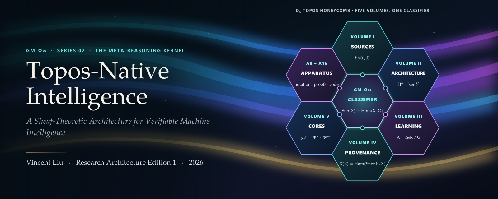
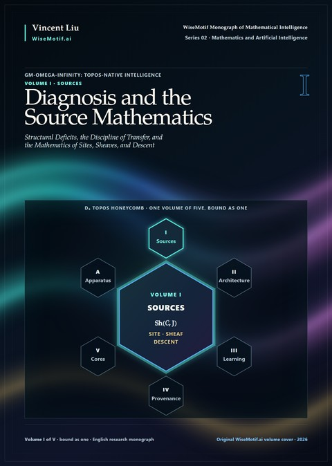
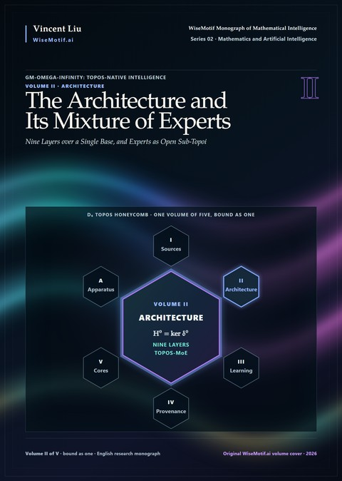
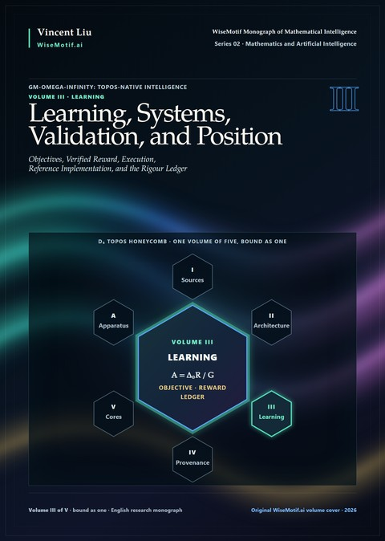
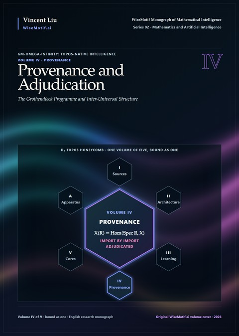
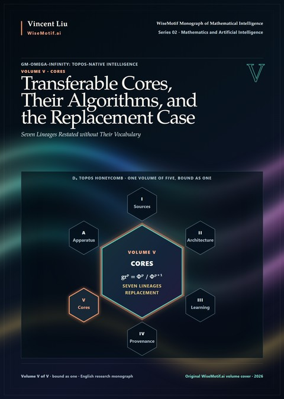
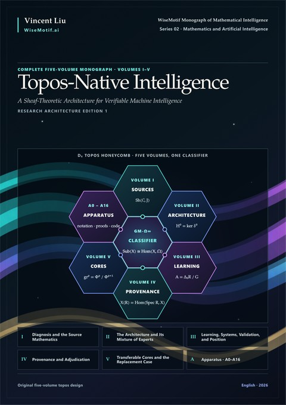

<p align="center">
  <a href="https://doi.org/10.5281/zenodo.23538544"></a>
</p>

<p align="center">
  <a href="https://doi.org/10.5281/zenodo.23538544"></a>
  <a href="https://creativecommons.org/licenses/by-nc-nd/4.0/"></a>
  <a href="https://github.com/AlienMuse/topos-native-intelligence/releases/tag/v1.0.0"></a>
  
  
  
  <a href="VERIFY.md"></a>
  <a href="VERIFY.md"></a>
</p>

<p align="center">
  <b><a href="https://github.com/AlienMuse/topos-native-intelligence/releases/download/v1.0.0/GM-Omega-Infinity-v1.0.0-Preview.pdf">Read the preview</a></b> (156 pages, 72.2 MB) ·
  <a href="#download">Download</a> ·
  <a href="#the-five-volumes">Volumes</a> ·
  <a href="#citation">Cite</a> ·
  <a href="VERIFY.md">Verify</a> ·
  <a href="README.zh-CN.md">中文</a>
</p>

<br>

> *Coherence is then a condition the architecture must discharge, where an ordinary model can only imitate it, and
> incoherence becomes an obstruction that can be computed and located.*
> <br>— Series Note

**GM-Omega-Infinity: Topos-Native Intelligence** — *A Sheaf-Theoretic Architecture for Verifiable Machine
Intelligence* — is a monograph in five volumes bound as one. It is the second work in the WiseMotif Monograph of
Mathematical Intelligence and the meta-reasoning kernel of the Grothendieckian Programme, whose central part is
[*The Grothendieckian Machine*](https://github.com/AlienMuse/grothendieckian-machine)
([doi:10.5281/zenodo.23480696](https://doi.org/10.5281/zenodo.23480696)). The first work set out how mathematical
worlds are built, compared and transported; this one asks what an intelligence must be, internally, if it is to
reason inside them: what makes an inference local, what obliges local inferences to agree, and what may be concluded
when they do not.

Its answer: **reasoning should be native to a topos.** A context is a site, the evidence it carries is a sheaf over
that site, and a conclusion is a global section that exists only where the local evidence glues.

<table>
  <tr>
    <td align="center"><b>5</b><br><sub>volumes,<br>bound as one</sub></td>
    <td align="center"><b>14 · 102</b><br><sub>parts ·<br>chapters</sub></td>
    <td align="center"><b>4,020</b><br><sub>pages</sub></td>
    <td align="center"><b>62,000+</b><br><sub>formulas<br>4,935 displayed</sub></td>
    <td align="center"><b>3,360</b><br><sub>numbered declarations<br>580 theorems · 1,234 propositions</sub></td>
    <td align="center"><b>380</b><br><sub>algorithms</sub></td>
    <td align="center"><b>124 · 550</b><br><sub>vector figures ·<br>tables</sub></td>
  </tr>
</table>

## The idea: reasoning native to a topos

The book began with a narrow question: what does the word *local* mean for a language model? A model reads a
context and makes claims that the context is supposed to support. Ask which parts of the context may support a claim,
and which collections of parts determine support on their union, and the standard architecture is silent. Without a
notion of covering, the sheaf condition — that data agreeing on overlaps glue to data on the whole — constrains
nothing. Such a model may still behave coherently. It is not obliged to, and **the distance between exhibiting a
property and being obliged to have it is the subject of this book.**

Following Grothendieck's way with hard problems — build the setting in which the problem becomes natural — the book
applies that turn to reasoning itself. Three consequences organise the whole architecture:

- **Agreement is a condition to be discharged.** Every layer states whether it preserves restriction and, if not,
  what it measures in its place.
- **Disagreement is information.** The obstruction to gluing is an output of the system — a class with a location
  and a size — not an error to be suppressed.
- **Change of context is a morphism.** Adaptation, transfer and retrieval are base change along a map of sites; what
  survives a change is what the map preserves.

### The kernel in seven operations

| Operation | What the kernel does |
|---|---|
| **Cover** | constructs a site from a pool of evidence, with a stated sufficiency criterion for covering families |
| **Assign** | places a sheaf over the site, with stalks of heterogeneous dimension and restriction maps |
| **Transport** | rebuilds attention as descent: values are carried into the shared stalk of an overlap and compared there |
| **Glue** | reconciles local sections into a global one by a normative solver with an exact reverse, or reports the residual |
| **Obstruct** | measures what fails to glue as a class on the overlaps where it lives; abstains without independent overlap data |
| **Decide** | evaluates propositions by Kripke–Joyal forcing, returning each verdict with the part of the site where it holds |
| **Change base** | transfers to a new context along a morphism of sites, stating what is preserved and what is forgotten |

## The five volumes

Each volume is organised around one question and ends with something a reader can take away and use. The five
volumes are bound as one book. Each cover below places its volume at the centre of the D₆ topos honeycomb, with the
formula its cell carries on the front cover of the book.

<table>
  <tr>
    <td width="33%" valign="top" align="center">
      <a href="docs/contents/volume-i.md"></a><br>
      <b>I · Diagnosis and the Source Mathematics</b><br>
      <sub>Parts I–II · 20 chapters · pp. 1–598</sub><br><br>
      <sub>Asks whether the deficits of present models are structural, and whether there is mathematics exact enough to name them. Delivers the diagnosis, the discipline of transfer, and a source layer — sites, sheaves, internal logic, ∞-topoi, cohomology and descent, Deligne weights, almost mathematics, Kan extensions, holonomy, the six operations, motives — in which every theorem the book relies on is stated with its hypotheses.</sub><br><br>
      <a href="docs/contents/volume-i.md">Contents</a> · <a href="https://github.com/AlienMuse/topos-native-intelligence/releases/download/v1.0.0/GM-Omega-Infinity-v1.0.0-Complete.pdf">PDF</a>
    </td>
    <td width="33%" valign="top" align="center">
      <a href="docs/contents/volume-ii.md"></a><br>
      <b>II · The Architecture and Its Mixture of Experts</b><br>
      <sub>Parts III–IV · 18 chapters · pp. 599–1,203</sub><br><br>
      <sub>Asks what an architecture looks like when that mathematics is spent on it. Delivers nine layers L0–L8 over a single base and Topos-MoE, in which an expert is an open sub-topos and routing is the construction of a sufficient cover — every construction graded, every invariant stated, every degeneration to the standard stack written down.</sub><br><br>
      <a href="docs/contents/volume-ii.md">Contents</a> · <a href="https://github.com/AlienMuse/topos-native-intelligence/releases/download/v1.0.0/GM-Omega-Infinity-v1.0.0-Complete.pdf">PDF</a>
    </td>
    <td width="33%" valign="top" align="center">
      <a href="docs/contents/volume-iii.md"></a><br>
      <b>III · Learning, Systems, Validation, and Position</b><br>
      <sub>Parts V–X · 22 chapters · pp. 1,204–1,885</sub><br><br>
      <sub>Asks how such an architecture is trained, run and checked. Delivers objectives with proofs of admissibility, reinforcement learning with verified reward, an execution model, a distributed and serving design, typed claim records and a reference implementation, and the instruments, metrics and ledger by which every claim can be tested.</sub><br><br>
      <a href="docs/contents/volume-iii.md">Contents</a> · <a href="https://github.com/AlienMuse/topos-native-intelligence/releases/download/v1.0.0/GM-Omega-Infinity-v1.0.0-Complete.pdf">PDF</a>
    </td>
  </tr>
  <tr>
    <td width="33%" valign="top" align="center">
      <a href="docs/contents/volume-iv.md"></a><br>
      <b>IV · Provenance and Adjudication</b><br>
      <sub>Part XI · 17 chapters · pp. 1,886–2,526</sub><br><br>
      <sub>Asks where the design comes from and what of its sources it is entitled to keep. Delivers an adjudication, import by import, of Grothendieck's programme, the functor of points, motives and the motivic fundamental group, and inter-universal Teichmüller theory, with the indeterminacy calculus and the law by which typed transfers compose.</sub><br><br>
      <a href="docs/contents/volume-iv.md">Contents</a> · <a href="https://github.com/AlienMuse/topos-native-intelligence/releases/download/v1.0.0/GM-Omega-Infinity-v1.0.0-Complete.pdf">PDF</a>
    </td>
    <td width="33%" valign="top" align="center">
      <a href="docs/contents/volume-v.md"></a><br>
      <b>V · Transferable Cores, Their Algorithms, and the Replacement Case</b><br>
      <sub>Parts XII–XIV · 25 chapters · pp. 2,527–3,218</sub><br><br>
      <sub>Asks what survives when each source is restated without its vocabulary. Delivers seven transferable cores — Grothendieck, Deligne, Faltings, Voevodsky, Scholze, Lurie, Mochizuki — their algorithms, a unified stack in which they interoperate, a machine-checking kernel, and a replacement assessment of what has been shown and what has not.</sub><br><br>
      <a href="docs/contents/volume-v.md">Contents</a> · <a href="https://github.com/AlienMuse/topos-native-intelligence/releases/download/v1.0.0/GM-Omega-Infinity-v1.0.0-Complete.pdf">PDF</a>
    </td>
    <td width="33%" valign="top" align="center">
      <a href="https://github.com/AlienMuse/topos-native-intelligence/releases/download/v1.0.0/GM-Omega-Infinity-v1.0.0-Complete.pdf"></a><br>
      <b>The complete monograph and its Apparatus</b><br>
      <sub>Volumes I–V · Appendices A0–A16 · 4,020 pages</sub><br><br>
      <sub>The five volumes bound as one, around the subobject classifier Ω. The Apparatus (pp. 3,219–3,911) is equipment for the whole work: notation, collected and expanded proofs, glossary, a worked example with code, algorithm compendium, normative pseudocode, pre-registered protocol, task generators, Lean 4 sources, attribution register, negative results, bibliography.</sub><br><br>
      <a href="https://github.com/AlienMuse/topos-native-intelligence/releases/download/v1.0.0/GM-Omega-Infinity-v1.0.0-Complete.pdf">PDF</a> · <a href="docs/contents/apparatus.md">Apparatus</a> · 105.6 MB
    </td>
  </tr>
</table>

## Selected results

- The non-abelian capacity of an orthogonal cellular sheaf is either zero or bounded below by a constant depending
  only on the stalk dimension — a binary certificate, not a continuous score.
- Generic weighted attention does **not** factor through the coend often invoked to explain it.
- For every *k* ≥ 2 there is a matched-budget instance on which top-*k* routing is strictly redundant.
- Second-order disagreement among experts is vacuous on a graph and on a contractible simplex; four experts on the
  boundary of a tetrahedron are the smallest configuration on which it can be non-trivial.
- The gluing loss used by sheaf neural networks has a data-independent minimiser, which explains their reported
  collapse to the identity sheaf and forbids that loss as a primary training term.
- The advantages of group-relative policy optimisation are the degree-zero Laplacian of the rollout nerve applied to
  the reward, under two normalisations.
- Under a declared numerical contract, a parameter injection realises the Transformer's forward map inside the
  architecture bitwise, with equal gradients and trajectory — an equality of programs in one direction only.

## What this work is — and is not

**It is** a work of foundations: the meta-reasoning kernel of a machine intelligence, specified precisely enough to
be implemented, tested and, if wrong, refuted. Every claim carries its grade where it is made — **T** theorem,
**M** measurable, **D** design criterion, **X** metaphor — and every unfinished obligation is printed as open.

**It is not** a replacement for the Transformer: several local specialisations are proved, their hypotheses differ,
and no theorem composes them into a single forward map. **It reports no experiment:** there is no trained model in
these pages, and every empirical statement is a pre-registered protocol awaiting its run. Inter-universal
Teichmüller theory is treated at length and kept in quarantine; nothing in the architecture depends on its
correctness.

## Where to start

| You are | Start with |
|---|---|
| a mathematician | Part II and the collected proofs (Appendices A1, A10), then the architecture |
| an engineer | Chapter 3.1 (architecture overview) and the compliance matrix of Chapter 1.3 |
| a learning researcher | Part I, then Parts V–VI and the experimental programme of Part IX |
| a sceptic | the rigour ledger of Part X and the replacement assessment of Part XIV |

The [preview](https://github.com/AlienMuse/topos-native-intelligence/releases/download/v1.0.0/GM-Omega-Infinity-v1.0.0-Preview.pdf) contains the front matter — Series Note, Preface,
Abstract, *How to read this book*, the contents — and the whole of Part I.

## The series

This work is Series 02 of the WiseMotif Monograph of Mathematical Intelligence. It belongs to the Grothendieckian Programme and addresses the question that the first work leaves open. The first two works of the series are bound closely together. From the third work on, each is a self-contained system on one problem, on which the Programme's method of recursive mathematical discovery is carried through in full. The seven works, in series order:

<table>
  <tr>
    <td width="96" valign="top" align="center"><a href="https://github.com/AlienMuse/grothendieckian-machine"></a></td>
    <td valign="top"><b>Series 01 · <a href="https://github.com/AlienMuse/grothendieckian-machine"><i>GAI-MUA: The Grothendieckian Machine</i></a></b><br>
      <sub><i>A Mathematical Universe Architecture for Verifiable and Self-Evolving Artificial Intelligence</i></sub><br>
      The central part of the Programme: how mathematical worlds are constructed, compared and carried from one setting to another, and how a machine may hold them as typed, versioned and verifiable objects.<br>
      <sub>6 volumes · 14,905 pages · <a href="https://doi.org/10.5281/zenodo.23480696">doi:10.5281/zenodo.23480696</a></sub></td>
  </tr>
  <tr>
    <td width="96" valign="top" align="center"></td>
    <td valign="top"><b>Series 02 · <i>GM-Omega-Infinity: Topos-Native Intelligence</i></b> — this work<br>
      <sub><i>A Sheaf-Theoretic Architecture for Verifiable Machine Intelligence</i></sub><br>
      The meta-reasoning kernel: what an intelligence must be, internally, if it is to reason inside such worlds.<br>
      <sub>5 volumes · 4,020 pages · <a href="https://doi.org/10.5281/zenodo.23538544">doi:10.5281/zenodo.23538544</a></sub></td>
  </tr>
  <tr>
    <td width="96" valign="top" align="center"><a href="https://github.com/AlienMuse/arithmetic-spectral-descent"></a></td>
    <td valign="top"><b>Series 03 · <a href="https://github.com/AlienMuse/arithmetic-spectral-descent"><i>Arithmetic Spectral Descent</i></a></b><br>
      <sub><i>Obstruction Theory, Hodge–Krein Realization, and a Falsifiable Architecture for the Riemann Hypothesis</i></sub><br>
      Research subject 1: the Riemann Hypothesis.<br>
      <sub>4 volumes · 1,549 pages · <a href="https://doi.org/10.5281/zenodo.23564898">doi:10.5281/zenodo.23564898</a></sub></td>
  </tr>
  <tr>
    <td width="96" valign="top" align="center"><a href="https://github.com/AlienMuse/fractured-adelic-geometry"></a></td>
    <td valign="top"><b>Series 04 · <a href="https://github.com/AlienMuse/fractured-adelic-geometry"><i>Fractured Adelic Geometry</i></a></b><br>
      <sub><i>A Foundational Framework for the Birch and Swinnerton-Dyer Conjecture</i></sub><br>
      Research subject 2: the conjecture of Birch and Swinnerton-Dyer.<br>
      <sub>4 volumes · 571 pages · <a href="https://doi.org/10.5281/zenodo.23585887">doi:10.5281/zenodo.23585887</a></sub></td>
  </tr>
  <tr>
    <td width="96" valign="top" align="center"><a href="https://github.com/AlienMuse/the-archimedean-prism"></a></td>
    <td valign="top"><b>Series 05 · <a href="https://github.com/AlienMuse/the-archimedean-prism"><i>The Archimedean Prism</i></a></b><br>
      <sub><i>Tame Period Geometry and the Hodge Conjecture</i></sub><br>
      Research subject 3: the Hodge Conjecture.<br>
      <sub>5 volumes · 1,309 pages · <a href="https://doi.org/10.5281/zenodo.23597954">doi:10.5281/zenodo.23597954</a></sub></td>
  </tr>
  <tr>
    <td width="96" valign="top" align="center"><a href="https://github.com/AlienMuse/strained-prismatic-geometry"></a></td>
    <td valign="top"><b>Series 06 · <a href="https://github.com/AlienMuse/strained-prismatic-geometry"><i>Strained Prismatic Geometry</i></a></b><br>
      <sub><i>Deformation over the Absolute Base and the abc Conjecture</i></sub><br>
      Research subject 4: the abc conjecture.<br>
      <sub>5 volumes · 1,666 pages · <a href="https://doi.org/10.5281/zenodo.23610034">doi:10.5281/zenodo.23610034</a></sub></td>
  </tr>
  <tr>
    <td width="96" valign="top" align="center"><a href="https://github.com/AlienMuse/the-arithmetic-topos"></a></td>
    <td valign="top"><b>Series 07 · <a href="https://github.com/AlienMuse/the-arithmetic-topos"><i>The Arithmetic Topos</i></a></b><br>
      <sub><i>Foundations of a Trace-Theoretic Approach to the Langlands Programme</i></sub><br>
      Research subject 5: the Langlands programme.<br>
      <sub>5 volumes · 2,001 pages · <a href="https://doi.org/10.5281/zenodo.23629681">doi:10.5281/zenodo.23629681</a></sub></td>
  </tr>
</table>

## Download

| File | Pages | Size |
|---|---:|---:|
| [**Complete monograph**](https://github.com/AlienMuse/topos-native-intelligence/releases/download/v1.0.0/GM-Omega-Infinity-v1.0.0-Complete.pdf) — Volumes I–V and apparatus | 4,020 | 105.6 MB |
| [Preview](https://github.com/AlienMuse/topos-native-intelligence/releases/download/v1.0.0/GM-Omega-Infinity-v1.0.0-Preview.pdf) — front matter and Part I | 156 | 72.2 MB |

The same files, with identical checksums, are archived at Zenodo: [doi:10.5281/zenodo.23538545](https://doi.org/10.5281/zenodo.23538545).
Covers are 600 ppi full-bleed; all fonts are embedded; the PDFs are linearised for fast opening.

## Citation

> Liu, V. (2026). *GM-Omega-Infinity: Topos-Native Intelligence — A Sheaf-Theoretic Architecture for Verifiable
> Machine Intelligence* (Research Architecture Edition 1, version 1.0.0). Zenodo. https://doi.org/10.5281/zenodo.23538544

```bibtex
@book{liu2026gmomegainfinity,
  author    = {Liu, Vincent},
  title     = {{GM-Omega-Infinity}: {Topos-Native Intelligence} --- A Sheaf-Theoretic Architecture for Verifiable Machine Intelligence},
  series    = {WiseMotif Monograph of Mathematical Intelligence, Series 02},
  edition   = {Research Architecture Edition 1},
  version   = {1.0.0},
  year      = {2026},
  publisher = {Zenodo},
  doi       = {10.5281/zenodo.23538544},
  url       = {https://doi.org/10.5281/zenodo.23538544}
}
```

GitHub's *Cite this repository* button uses [CITATION.cff](CITATION.cff). The concept DOI 10.5281/zenodo.23538544 always resolves to
the latest version; cite the version DOI 10.5281/zenodo.23538545 to refer to these exact files.

## Authenticity

Every file of the release is listed in `SHA256SUMS`, signed with OpenPGP and timestamped twice (RFC 3161 and
OpenTimestamps on Bitcoin). The signing key is the same as for Series 01.

Signing key fingerprint: `DA1A 1AEF D8B2 C17C FF3F 1D1B 3905 0F50 7A4F EC17`

GitHub releases of this repository are immutable. Copies obtained elsewhere that do not match `SHA256SUMS` are not
authentic. Three levels of verification: [VERIFY.md](VERIFY.md).

## License and AI use

The work is licensed under [CC BY-NC-ND 4.0](LICENSE): you may share it unchanged, with attribution, for
non-commercial purposes. Code listings and machine-readable schemas printed in the work are additionally available
under the Apache License 2.0. Translations and other uses require written permission. Details:
[NOTICE.md](NOTICE.md) · Name use: [TRADEMARKS.md](TRADEMARKS.md).

**Text and data mining rights are reserved** under Article 4(3) of Directive (EU) 2019/790. Training or fine-tuning
machine-learning models on the work is not permitted without written permission. Individual readers may use AI
tools to read, search, explain or translate the work for their own study. Full policy:
[TDM-AND-AI-POLICY.md](TDM-AND-AI-POLICY.md).

## Contributing

This book is finished only when other people have tried to break it, and it is written to make that easy. Three
kinds of contribution matter most:

- **Refutation** — a counterexample to a theorem, a failure of a stated degeneration, or an experiment in which a
  module fails the gate it names.
- **Completion** — the obligations printed as open are stated precisely enough to be taken up.
- **Construction** — an implementation of the frozen-site subset, run against the pre-registered programme.

Report errors through an [errata issue](https://github.com/AlienMuse/topos-native-intelligence/issues/new?template=errata.yml). Accepted corrections are
acknowledged by name in the next edition (see [ERRATA.md](ERRATA.md)).

---

<p align="center"><sub>
  <a href="https://wisemotif.ai">WiseMotif Monograph of Mathematical Intelligence</a> · Series 02 · Mathematics and Artificial Intelligence<br>
  Series 01: <a href="https://github.com/AlienMuse/grothendieckian-machine"><i>GAI-MUA: The Grothendieckian Machine</i></a> ·
  Series 03: <a href="https://github.com/AlienMuse/arithmetic-spectral-descent"><i>Arithmetic Spectral Descent</i></a> ·
  Series 04: <a href="https://github.com/AlienMuse/fractured-adelic-geometry"><i>Fractured Adelic Geometry</i></a> ·
  Series 05: <a href="https://github.com/AlienMuse/the-archimedean-prism"><i>The Archimedean Prism</i></a> ·
  Series 06: <a href="https://github.com/AlienMuse/strained-prismatic-geometry"><i>Strained Prismatic Geometry</i></a> ·
  Series 07: <a href="https://github.com/AlienMuse/the-arithmetic-topos"><i>The Arithmetic Topos</i></a><br>
  © 2026 Vincent Liu
</sub></p>
